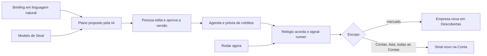

# Spec: Agente de Sinal e Agente de Contas

**Status:** open (a direção foi aprovada pelo Kauê em 23/10/2026; a [ADR-0032](../../docs/adr/0032-agente-de-sinal-e-agente-de-contas.md) está como Proposta e as decisões marcadas `DECISÃO PENDENTE` seguem em aberto; as de 2, 3, 4, 8, 10, 13, 14 e 15 foram decididas em 24/10/2026)

**Frente:** Sinais e Contas. Guia geral: [`docs/visao-geral-da-plataforma.md`](../../docs/visao-geral-da-plataforma.md). Decisões que valem aqui: [ADR-0002](../../docs/adr/0002-permissoes-ler-propor-executar.md) (o Agente propõe, a pessoa decide), [ADR-0004](../../docs/adr/0004-coordenacao-sem-quinto-agente.md), [ADR-0005](../../docs/adr/0005-agentes-criados-a-partir-de-especialidades.md), [ADR-0007](../../docs/adr/0007-sinal-disparado-torna-conta-quente.md), [ADR-0018](../../docs/adr/0018-motor-dos-agentes-na-edge-function.md) e [ADR-0019](../../docs/adr/0019-creditos-e-cobranca-por-usuario.md). Pontos de partida: [`.scratch/modulo-de-sinais/`](../modulo-de-sinais/spec.md), [`.scratch/sinais-reais/`](../sinais-reais/spec.md) e [`.scratch/sinal-candidata-e-descoberta/`](../sinal-candidata-e-descoberta/spec.md).

## Problema

Hoje o Cliente configura um Sinal escolhendo um tipo do catálogo, preenchendo o formulário daquele tipo e ativando um Monitoramento que roda a cada N horas. Ele pensa em formulários e intervalos quando o que quer é dizer "me avise quando uma dessas empresas abrir vaga de RevOps", e não vê quanto vai gastar. Quem trabalha em Contas e Contatos também não tem como pedir, em linguagem natural, "mostre as Contas sem Sinal há 60 dias e rode Sinais nelas".

## Visão

**Sinal como um bot.** A pessoa descreve em linguagem natural o que quer (o **Briefing**). A IA monta um **Plano** estruturado e editável. A pessoa escolhe a **Agenda** (quantas Rodadas por dia e em quais horários) e vê os créditos por Rodada, por dia e por mês antes de ativar. Nos horários, o relógio (`pg_cron` `althius-signal-runner`) acorda o `signal-runner`, que executa só o Plano aprovado. O resultado chega como empresa nova em Descobertas (escopo mercado) ou como Sinal novo numa Conta conhecida (escopo Contas ou lista), sempre com o "por que apareceu".

**Escopo do Sinal:** `mercado` (descobre empresas novas), `lista` (lista importada ou salva), `contas` (Contas escolhidas a dedo) ou `todas_as_contas`.

**Modelos** (decisão do Kauê, 23/10/2026, 14h19 BRT): o catálogo de Sinais continua, mas vira Modelos. Cada Modelo é um plano-semente versionado, pré-configurado com a IA (Briefing pronto, Plano editável, Agenda sugerida, estimativa de créditos), e não um tipo fixo de formulário. A pessoa usa um Modelo e ajusta, ou descreve o próprio Sinal. Nos dois caminhos só roda o Plano aprovado, com o custo em créditos visível antes de ativar.

**Cobrança por rodada** (decisão do Kauê): cada Rodada gasta créditos do Cliente. Mais Rodadas, mais créditos, por escolha do Cliente. Há limites seguros: intervalo mínimo, máximo por dia, teto diário por Sinal, e um comportamento definido quando o saldo acaba.

**Agente de Contas:** um chat dentro de Contas e Contatos que busca, filtra e lê Contas e Candidatas, pede enriquecimento (com custo), propõe aceitar ou descartar e transforma uma conversa num rascunho de Sinal ("roda Sinais nessas Contas").

## Regras

1. Por baixo, o Sinal do Cliente continua sendo um Monitoramento (`private.signal_monitors`). Briefing, Plano e Agenda são a cara nova dele, não um segundo sistema. Não se cria outro relógio nem outro runner.
2. **Só o Plano aprovado roda, nunca o texto livre.** O Briefing nunca vai ao `signal-runner`. Editar o Plano cria uma versão nova que também precisa de aprovação; a Rodada em andamento termina com a versão com que começou.
3. O servidor valida o Plano contra as fontes disponíveis e os limites. O texto do Briefing é dado não confiável: não escolhe fonte, preço nem limite.
4. A Rodada é idempotente: a chave é o Sinal e a hora marcada da Rodada, então repetir nunca cobra nem grava duas vezes (como no `signal-runner` de hoje).
5. O Cliente vê só créditos. Nunca US$, custo de fornecedor, nome de actor, valor de Teto nem as letras de nicho A–H. Erro real fica no log técnico; o Cliente vê mensagem neutra da marca (`_shared/marca.ts`).
6. Nada neste fluxo envia mensagem a um Contato, cria Conta-alvo ou cria Sequência sozinho. Aceitar uma Candidata continua sendo decisão de uma pessoa.
7. O Agente de Contas propõe e rascunha ([ADR-0002](../../docs/adr/0002-permissoes-ler-propor-executar.md)): enriquecer com custo, aceitar, descartar e ativar dependem de uma pessoa, e o rascunho de Sinal só roda como Plano aprovado.
8. O Agente de Contas não é a Coordenação ([ADR-0004](../../docs/adr/0004-coordenacao-sem-quinto-agente.md)), e nenhum dos dois termos novos é uma Especialidade nova enquanto a decisão 1 estiver em aberto.
9. Tudo pertence a um Workspace; RLS em toda tabela nova; acesso só por funções com a Participação conferida (`auth.uid()`); testes de permissão em pgTAP.
10. Cada decisão pendente é implementada com o padrão recomendado, isolado num lugar fácil de trocar (constante no servidor ou campo de configuração), e listada no PR. Nunca se escreve que o padrão "foi decidido".
11. A Demonstração é só dos fundadores: não pode quebrar, mas não ganha conteúdo novo além do mínimo para os testes.
12. Conectores e canais (`conexoes.tsx`, `integration-*`, `slack-*`) são do Renan e não entram nesta frente.

## Decisões

As de 2, 3, 4, 8, 10, 13, 14 e 15 foram decididas pelo Kauê em 24/10/2026 (ticket 05, ajustes das decisões); as demais seguem pendentes. Texto completo e padrão recomendado de cada uma na [ADR-0032](../../docs/adr/0032-agente-de-sinal-e-agente-de-contas.md#decisões-em-aberto). Em qual ticket cada uma pesa:

| # | Decisão | Ticket |
| --- | --- | --- |
| 1 | Barra lateral; o Agente de Contas é Especialidade nova ou o Scopus reposicionado | 13, 14 |
| 2 | Preço por rodada: fixo por fonte, pelo lote. **Decidido pelo Kauê em 24/10/2026** | 04, 05 |
| 3 | Agenda: 1 h entre Rodadas, até 12 por dia, padrão 08:00 em dias úteis. **Decidido pelo Kauê em 24/10/2026** | 03, 05 |
| 4 | Teto: o automático exige, "Rodar agora" não; o campo já vem preenchido (custo do mês + 20%). **Decidido pelo Kauê em 24/10/2026** | 02, 04, 05 |
| 5 | Validar `vaga_mercado` em produção (operacional) | fora do código |
| 6 | Página de Sinais em "Meus Sinais" e "Modelos" | 14 |
| 7 | Lista importada: "Importar como Contas-alvo" ou "Só monitorar" | 07 |
| 8 | Um Sinal por Plano; o Sinal pai fica de fora por ora. **Decidido pelo Kauê em 24/10/2026** | 08 |
| 9 | Lista fixa ou dinâmica | 06 |
| 10 | Limites para listas: até 500 Contas, até 100 por Rodada com padrão 25, em rotação, sem limite de Rodadas por tamanho de lista. **Decidido pelo Kauê em 24/10/2026** | 05 |
| 11 | Conta nova roda Sinais | 10 |
| 12 | Ordem: começar pelo escopo Contas | todos |
| 13 | Gerar o Plano pela IA: sem crédito, 20 por dia. **Decidido pelo Kauê em 24/10/2026** | 01 |
| 14 | Pausa automática depois de 3 Rodadas puladas; aviso já na 1ª. **Decidido pelo Kauê em 24/10/2026** | 04, 05 |
| 15 | Limite por dia opcional (sugerido: custo máximo de um dia) e aviso de repetição acima de 2 por dia. **Decidido pelo Kauê em 24/10/2026** | 04 |

## Ordem dos tickets

O primeiro corte ponta a ponta é 01 a 04, no escopo Contas (decisão 12: os actors já estão `available`). O escopo `mercado` já existe no banco (`audience.escopo`) e entra pelo mesmo Plano quando `vaga_mercado` estiver validada em produção (decisão 5). Os demais seguem a ordem abaixo, cada um com o seu PR.

| # | Ticket | Prompt | Status |
| --- | --- | --- | --- |
| 01 | [Plano do Sinal](issues/01-plano-do-sinal.md) | 30-02 | ready-for-agent |
| 02 | [Rodar agora e registro da Rodada](issues/02-rodar-agora-e-registro.md) | 30-03 | ready-for-agent |
| 03 | [Agenda por horários](issues/03-agenda-por-horarios.md) | 30-04 | ready-for-agent |
| 04 | [Preço por rodada e limites](issues/04-preco-por-rodada-e-limites.md) | 30-05 | ready-for-agent |
| 05 | [Escopo lista e todas as Contas](issues/05-escopo-lista-e-todas-as-contas.md) | | open |
| 06 | [Listas de Contas](issues/06-listas-de-contas.md) | | open |
| 07 | [Importação para Sinais](issues/07-importacao-para-sinais.md) | | open |
| 08 | [Sinal com vários tipos](issues/08-sinal-com-varios-tipos.md) | | open |
| 09 | [Resumo e aviso de novidades](issues/09-resumo-e-aviso-de-novidades.md) | | open |
| 10 | [Conta nova roda Sinais](issues/10-conta-nova-roda-sinais.md) | | open |
| 11 | [Modelos](issues/11-modelos.md) | | open |
| 12 | [Mais fontes no planejador](issues/12-mais-fontes-no-planejador.md) | | open |
| 13 | [Agente de Contas](issues/13-agente-de-contas.md) | | open |
| 14 | [Página de Sinais reorganizada](issues/14-pagina-de-sinais-reorganizada.md) | | open |
| 15 | [Limpeza](issues/15-limpeza.md) | | open |

Nota (26/10/2026): os tickets 11 (Modelos) e 14 (Página de Sinais reorganizada) são absorvidos pelos tickets 06 e 09 de [`.scratch/sinais-first/`](../sinais-first/spec.md); o 13 (Agente de Contas) segue adiado (ADR-0033, D8); o 15 (Limpeza) continua aqui, sem relação com a retirada das quatro Especialidades tratada em `sinais-first`.

## Fora de escopo

- Conectores e integrações (HubSpot, Slack, WhatsApp, Clay, canais).
- Enviar mensagem, criar Conta-alvo ou criar Sequência a partir de um Sinal.
- Mudar o motor dos Agentes ([ADR-0018](../../docs/adr/0018-motor-dos-agentes-na-edge-function.md)) ou o login do Hermes.
- Aplicar migration em produção, publicar Edge Function ou o worker do Hermes: isso é do Grok Bot, depois do "Sim, aplica e publica" do Kauê.

## Testes

Cada ticket traz o seu: pgTAP para o que mexer no banco (determinístico, sem depender da ordem de linhas com o mesmo `created_at`), Deno para as funções tocadas, Vitest para a tela. Antes do push, em `projeto-althius-frontend`: `npm ci && npm run lint && npm test -- --run && npm run build`; `deno check` e `deno test` das funções tocadas; `supabase db reset && supabase test db` (três vezes seguidas, todas verdes). CI verde nos três jobs é condição do PR.
