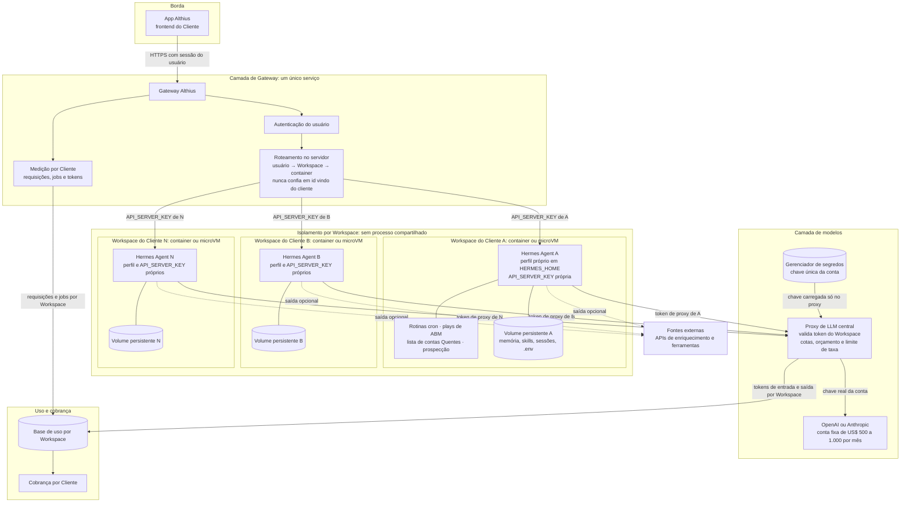
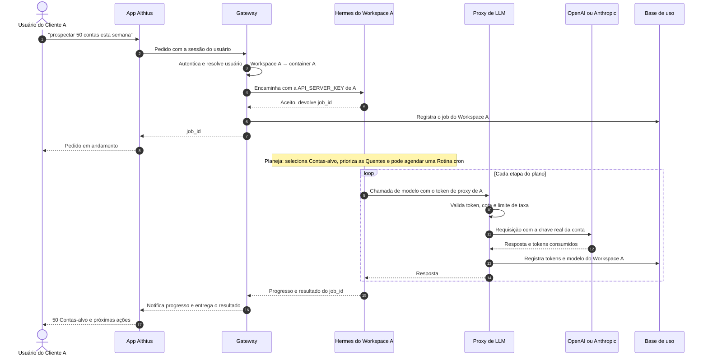

# Arquitetura multi-tenant do Hermes Agent na Althius

**Status:** proposta, rascunho de arquitetura. Nada disto está implementado.

A ideia é usar o [Hermes Agent](https://github.com/NousResearch/hermes-agent), da Nous Research, como o motor operacional autônomo da Althius, atendendo vários Clientes pagantes. Como o Hermes é um agente pessoal e single-tenant, a proposta é rodar uma instância isolada por Workspace, atrás de um Gateway próprio e de um proxy de LLM central que guarda a única chave da conta de modelos. Neste documento, "tenant" é o Workspace de um Cliente, no sentido do `CONTEXT.md`.

## Visão geral

## Fluxo de um pedido

Jobs longos são assíncronos: a resposta imediata é um `job_id`, e o progresso e o resultado chegam ao app quando ficam prontos, por notificação ou consulta ao `job_id`.

## Por que um container por Cliente, e não um processo compartilhado

- Os usuários são externos e não confiáveis. O `SECURITY.md` do Hermes o define como agente pessoal single-tenant, cuja única fronteira de segurança é o sistema operacional.
- Parte do estado é global no processo, como o registro de servidores MCP e as ferramentas de terminal. Dois Workspaces no mesmo processo poderiam ver ferramentas, arquivos ou credenciais um do outro.
- Cada Workspace tem o seu perfil Hermes, com `HERMES_HOME` próprio (`config`, `.env`, memória, sessões, `skills`, `cron`) num volume persistente só dele.
- Limita o raio de impacto: prompt injection, bug ou vazamento de credencial fica restrito a um Cliente.
- Permite limites de CPU, memória e rede por Workspace, e egress controlado para fontes externas.
- O custo fica sob controle com um pool de instâncias pré-aquecidas e com suspender e retomar containers ociosos, mantendo o volume. É o padrão do agent-sandbox do Kubernetes e do hermes-as-service.

## Onde fica a chave da conta GPT

- Só no proxy de LLM, carregada de um gerenciador de segredos. Nunca entra em imagem, volume ou `.env` de container.
- Cada container recebe apenas a URL base do proxy e um token de proxy do seu Workspace, revogável a qualquer momento.
- A chave real pode ser rotacionada no proxy sem tocar nos containers dos Clientes.
- O proxy aplica cota, orçamento e limite de taxa por Workspace, para que um Cliente não esgote a conta mensal compartilhada.
- A `API_SERVER_KEY` de cada Hermes é interna: só o Gateway a conhece, e o app nunca fala direto com um container.

## Como funciona a medição e a cobrança

- O proxy registra, a cada requisição, Workspace, modelo e tokens de entrada e saída.
- O Gateway registra requisições e jobs por Workspace.
- Os dois alimentam uma base de uso, agregada por Cliente e período.
- A cobrança pode ser preço do plano mais excedente, ou custo mais margem.
- Alertas de orçamento avisam quando um Workspace se aproxima da cota, antes de o proxy bloquear.

## Referências

- Hermes Agent, `SECURITY.md` (single-tenant, o sistema operacional como única fronteira): https://github.com/NousResearch/hermes-agent/blob/main/SECURITY.md
- Hermes Agent, discussão sobre multi-tenant: https://github.com/NousResearch/hermes-agent/issues/34352
- Hermes Agent, repositório (perfis com `HERMES_HOME` próprio e servidor de API compatível com OpenAI com `API_SERVER_KEY` por perfil): https://github.com/NousResearch/hermes-agent
- Kubernetes agent-sandbox, "Hermes Agents as a Service" (sandbox e PVC por usuário, pool pré-aquecido, suspender e retomar): https://agent-sandbox.sigs.k8s.io/docs/use-cases/examples/hermes-agents-as-a-service/
- masumi-network, hermes-as-service (uma microVM Firecracker por usuário, chave do OpenRouter só no proxy de LLM do orquestrador): https://github.com/masumi-network/hermes-as-service
