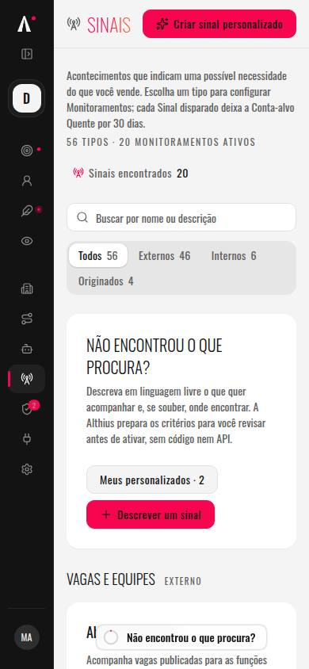
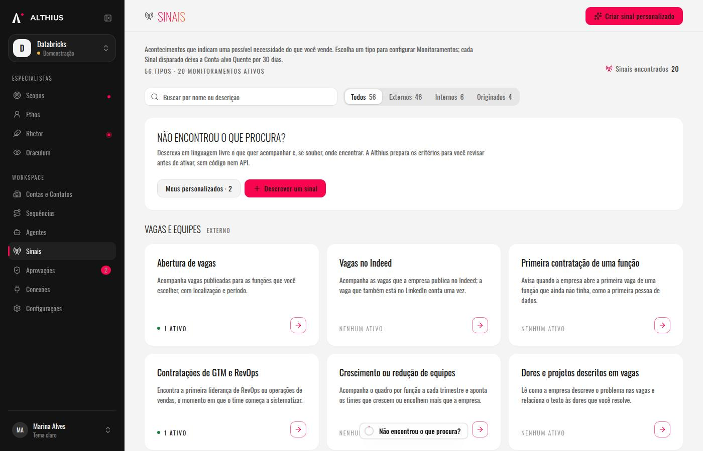

# 16: Criar Monitoramento nas cascatas disponíveis e ver Sinais de mercado

**What to build:** na página Sinais, o cartão de cascata em estado `available` e escopo de Conta ganha o botão "Criar Monitoramento", que abre o fluxo de criação já preenchido com a cascata e grava por `save_signal_monitor`. O cartão de escopo Mercado abre "Ver Sinais de mercado", a leitura do feed `private.market_signals` do ICP daquele cartão no Workspace. O cartão que não está disponível continua explicando o motivo (em teste ou sem fonte) e não oferece criar. No celular (390 px), o cartão de Sinais deixa de nascer espremido a cerca de 62 px.

**Blocked by:** nenhum. O ticket 13 já mostra o cartão e a RPC `list_cascade_catalog`. `save_signal_monitor` já aceita cascata `available` por `private.available_signal_origin`.

**Status:** ready-for-human

## GATE

- Sem bloqueio de outro ticket. Pode implementar.
- Não aplicar migração no projeto remoto `ycbdilsmydvzezhlymty`. Não publicar função. Não fazer deploy.
- A migração nova tem timestamp maior que `20261014170000`.
- Ao terminar o código, o status passa a `ready-for-human`: falta o Nan aplicar a migração e publicar o frontend.

## O que construir

1. **Cartão de Conta `available`.** Botão "Criar Monitoramento" abre o fluxo de criação já com o nome e o tipo da cascata. O público é o do ICP do Workspace (na Demonstração, o público recomendado "ICP do Workspace"; no operacional, as Contas-alvo do Workspace, sem listas de exemplo e sem descoberta por perfil). A revisão diz o modo da varredura (confirmar ou automático) e o teto de créditos, com o caminho para Automação e tetos. Salvar chama `save_signal_monitor` com `p_signal_type` da cascata. Cartão `testing` ou `sem_fonte` de Conta segue só com a explicação, sem botão.
2. **Cartão de Mercado.** Link "Ver Sinais de mercado" abre a vista do ICP daquele cartão. A vista lista o feed do Workspace por uma RPC nova, `security definer`, com `require_active_membership`, `search_path` vazio, e colunas só de leitura segura: id, tipo, nome, frase e data. Sem fonte, evidência, chave, payload nem dado pessoal (e-mail, CPF, telefone e nome de fornecedor na frase viram uma frase neutra). Se a cascata está `available`, a vista explica como ativar o Monitoramento (o mesmo fluxo, respeitando ICP, teto e Automação). Se está em teste ou sem fonte, explica o motivo e não oferece criar.
3. **Largura no celular.** A 390 px o cartão de Sinais ocupa a largura útil da página, não ~62 px. A barra lateral larga mais o respiro `px-10` é o que espremia o miolo (390 − 248 − 80 = 62).

## Pode mexer

- Uma migração nova e o pgTAP dela (`supabase/tests/`).
- `projeto-althius-frontend/src/fonte/` (leitura do feed e gravação do Monitoramento de cascata).
- `projeto-althius-frontend/src/paginas/sinais/` (cartão, fluxo, vista) e a rota em `App.tsx`.
- A casca e o respiro da página, só o bastante para o cartão caber a 390 px (`casca.tsx`, `pagina.tsx`).

## Não mexa

- O motor de cascata, `signal-runner`, o Hermes e as migrações já na `main`.
- `list_cascade_catalog()` e `list_market_signals()`: o contrato delas fica. A leitura da tela é a RPC nova.
- `save_signal_monitor`: não redefinir. A tela chama a que já existe.
- Nada de aplicar migração, publicar função ou mexer em segredo em produção.
- Nomes de fornecedor em texto que a pessoa lê. O produto não se chama CRM.

## Critérios

- [x] Vitest vermelho antes do código: o botão, o fluxo preenchido, a vista e a Fonte.
- [x] pgTAP da RPC nova escrito antes da migração. O job Banco do CI o executa.
- [x] Cartão `available` de Conta cria Monitoramento por `save_signal_monitor`, com o ICP do Workspace, o teto e o modo de Automação.
- [x] Cartão em teste ou sem fonte não tem o botão e diz o motivo.
- [x] Vista de Mercado lista só o feed do ICP do Workspace, sem dado pessoal, e diz como ativar quando a cascata está disponível.
- [x] A 390 px o cartão de Sinais fica bem mais largo que 62 px.
- [x] Nenhum texto novo cita fornecedor.

## Passos do Nan

**A IA que executar este ticket avisa o Nan, com os comandos prontos para o PowerShell, antes de declarar o ticket pronto. Nunca pula um passo manual, nunca pede chave ou senha no chat e nunca roda no remoto o que é do Nan.**

1. Com o CI verde, aplicar no projeto `ycbdilsmydvzezhlymty` a migração `supabase/migrations/20261014180000_sinais_de_mercado_na_tela.sql`, pelo `execute_sql` em bloco atômico, como em `docs/agents/migrations.md`. Não usar `apply_migration`. Não aplicar daqui.

   No PowerShell, na raiz do repositório:

   ```powershell
   $m = Get-Content -Raw .\supabase\migrations\20261014180000_sinais_de_mercado_na_tela.sql
   Get-FileHash .\supabase\migrations\20261014180000_sinais_de_mercado_na_tela.sql -Algorithm MD5
   ```

   O `$m` entra verbatim no bloco abaixo (o arquivo usa `$$`; as marcas de fora são `$apply$` e `$mig$`). Enviar um único `execute_sql`:

   ```sql
   do $apply$
   declare
     m text := $mig$<conteúdo verbatim de 20261014180000_sinais_de_mercado_na_tela.sql>$mig$;
   begin
     execute m;
     insert into supabase_migrations.schema_migrations (version, name, statements, created_by)
     values ('20261014180000', 'sinais_de_mercado_na_tela', array[m], 'nan');
   end
   $apply$;
   ```

   Conferir que `md5(statements[1])` em `supabase_migrations.schema_migrations` bate com o hash do arquivo, e que os avisores de segurança não mostram nada novo. O pgTAP é `supabase/tests/sinais_de_mercado_na_tela.sql` (`plan(14)`).

2. Publicar o frontend pelo fluxo normal do repositório. Não há função nova para publicar.

   ```powershell
   cd projeto-althius-frontend
   npm ci
   npm run build
   ```

3. Numa Workspace de teste, abrir Sinais no celular (390 px) e no desktop: cartão disponível de Conta com "Criar Monitoramento"; cartão em teste sem o botão; cartão de Mercado com "Ver Sinais de mercado".

## Comments

- 2026-10-13: código na branch `cursor/monitoramento-e-sinais-de-mercado-2567`. PR: https://github.com/Kauedz/Althius/pull/195 (não mergear daqui). Vitest do botão, do fluxo, da vista e da Fonte ficou vermelho antes da implementação e verde depois. Suíte inteira do frontend: 139 arquivos, 1252 testes, exit 0. `npx tsc -b` limpo. oxlint sem erro. pgTAP `plan(14)` não rodou aqui (sem Postgres, Docker nem Supabase CLI); o job Banco do CI executa `supabase/tests/sinais_de_mercado_na_tela.sql`. No Chrome, `/sinais?demo=true`: cartão a 390 px com 290 px de largura (antes ~62), sem rolagem horizontal; a 360 px, 260 px; a 1400×900, grade de várias colunas. A Demonstração não traz cascata, então o botão e a vista de mercado foram exercitados no Vitest, não no navegador.

- 2026-10-13: o job Banco do CI falhou com "planned 16 tests but ran 14" e zero asserts vermelhos. A migração do zero aplicou. O arquivo tem 14 asserts; o `plan(16)` estava a mais. Corrigido para `plan(14)`.




