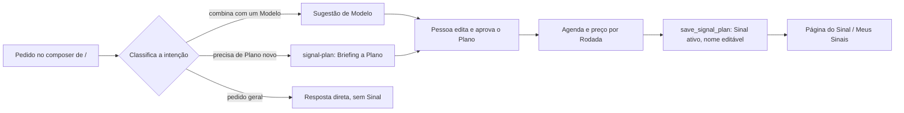

# Spec: Sinais first (o composer cria Sinais; as quatro Especialidades saem do produto)

**Status:** open (direção aprovada pelo Renan em 26/10/2026, 15:40 BRT; ADR-0033 aceita)

**Frente:** Agentes e Sinais. Guia geral: [`docs/visao-geral-da-plataforma.md`](../../docs/visao-geral-da-plataforma.md). Decisão central: [ADR-0033](../../docs/adr/0033-sinais-first.md). Decisões que continuam valendo: [ADR-0032](../../docs/adr/0032-agente-de-sinal-e-agente-de-contas.md) (Briefing/Plano/Agenda/Rodada, Modelos, cobrança por Rodada — tudo que não está listado como substituído na ADR-0033), [ADR-0002](../../docs/adr/0002-permissoes-ler-propor-executar.md) (o Agente propõe, a pessoa decide), [ADR-0004](../../docs/adr/0004-coordenacao-sem-quinto-agente.md) (substituída em parte), [ADR-0005](../../docs/adr/0005-agentes-criados-a-partir-de-especialidades.md) (substituída), [ADR-0006](../../docs/adr/0006-aderencia-como-classificacao-unica.md) e [ADR-0007](../../docs/adr/0007-sinal-disparado-torna-conta-quente.md) (Aderência e Quente, sem mudança), [ADR-0018](../../docs/adr/0018-motor-dos-agentes-na-edge-function.md) (motor dos Agentes, sem mudança de contrato). Pontos de partida: [`.scratch/agente-de-sinal/`](../agente-de-sinal/spec.md) (os tickets 01–04 já estão na `main`; os tickets 11, 13, 14 e 15 são absorvidos ou adiados aqui — ver tabela de decisões), [`.scratch/pagina-de-agentes/`](../pagina-de-agentes/spec.md) (o protótipo da página de Agentes e do composer atual) e [`.scratch/playbook-do-workspace/`](../playbook-do-workspace/spec.md) (a seção `icp` do Playbook, que o ICP estruturado único passa a usar como uma de suas fontes).

## Problema

O Renan quer que a Althius seja "Sinais first": a pessoa descreve em linguagem natural o que quer monitorar, e a plataforma sobe um Agente de Sinal dedicado àquele pedido, como um assistente pessoal que gera um bot por pedido. Hoje isso não existe: a tela inicial (`/`) mostra uma grade de 4 Agentes genéricos (Scopus, Ethos, Rhetor, Oraculum) e um composer que só sabe dividir um pedido entre eles ([ADR-0004](../../docs/adr/0004-coordenacao-sem-quinto-agente.md)); criar um Sinal exige sair dessa tela e entrar em `/sinais/novo`. A [ADR-0032](../../docs/adr/0032-agente-de-sinal-e-agente-de-contas.md) já construiu o mecanismo por trás do Sinal (Briefing → Plano → Agenda → Rodada, com preço e limites, nos tickets 01–04 de `.scratch/agente-de-sinal/`, já na `main`), mas manteve explicitamente as 4 Especialidades como produto permanente — o oposto do que o Renan quer agora.

Ao mesmo tempo, o ICP do Workspace está hoje espalhado em três lugares que não se falam: o mini-ICP do onboarding (texto livre), a seção `icp` do Playbook do Workspace (texto e tabela, versionada) e a letra de nicho A–H de cada cascata de Sinal. Nenhum deles ranqueia o catálogo de Sinais nem classifica a Aderência das empresas que um Sinal de mercado encontra.

## Visão / Solução

**O composer de `/` cria Sinais.** A pessoa descreve o que quer; a Althius primeiro tenta casar o pedido com um Modelo do catálogo e, se não achar um bom Modelo, monta um Plano novo pelo `signal-plan` já existente. Os dois caminhos terminam do mesmo jeito: um Plano editável, com Agenda e preço por Rodada visíveis, que vira um Sinal ativo só depois de aprovado — exatamente como hoje em `/sinais/novo`, só que iniciado pelo composer. O mesmo composer responde direto perguntas gerais, sem forçar a criação de um Sinal.

**As quatro Especialidades saem do produto.** Scopus, Ethos, Rhetor e Oraculum deixam de ser Agentes que o Cliente vê, usa ou cria. Seus dados (Memória, Conversas, Habilidades, Rotinas) ficam só leitura, sem migração ([ADR-0033](../../docs/adr/0033-sinais-first.md), D1). A escrita de Sequência e a auditoria de presença em LLM — hoje "Rhetor" e "Oraculum" — viram passo e ferramenta internos (D3). A retirada segue uma ordem segura: esconder da interface, desacoplar o Rhetor, parar de semear Agente novo, só por último mexer no schema, sem apagar nada (D9).

**Um ICP estruturado único.** Passa a existir um registro de ICP por Workspace, estruturado, que o onboarding semeia, o Playbook aprova ao editar, o catálogo usa para ranquear ("Para o seu nicho"), o `signal-plan` usa como contexto do prompt, e que dá Nível de Aderência às empresas que um Sinal de escopo mercado encontra (D5).

**Catálogo e preço continuam como estão.** O catálogo de Sinais vira Modelos (D4, ADR-0032 decisão 4): cada card lança um Plano-semente já configurado. O preço de um Sinal criado pelo composer é o preço de sempre: por Rodada, em créditos, com os limites já decididos pelo Kauê em 24/10/2026 (D6).

## Histórias de usuário

### Composer cria Sinal
1. Como Cliente, quero descrever em linguagem natural o que eu quero monitorar na tela inicial, para que a Althius crie um Sinal para isso sem eu precisar entender Briefing, Plano ou Agenda antes de começar.
2. Como Cliente, quero que a Althius primeiro tente achar um Modelo do catálogo parecido com o meu pedido, para aproveitar um Plano já pronto em vez de montar um do zero.
3. Como Cliente, quero ver os Modelos sugeridos antes de confirmar, com a opção de usar um deles ou seguir descrevendo o meu próprio Sinal, para escolher o caminho mais rápido.
4. Como Cliente, quero que, sem Modelo compatível, meu pedido vire um Briefing que a IA transforma num Plano editável, do mesmo jeito que `/sinais/novo` já faz hoje.
5. Como Cliente, quero revisar e aprovar o Plano, escolher a Agenda e ver o preço por Rodada, por dia e por mês antes de o Sinal ficar ativo, para nunca ser surpreendido pelo gasto.
6. Como Cliente, quero que o Sinal criado pelo composer já tenha um nome, gerado a partir do meu pedido, e poder editá-lo, para reconhecê-lo depois em "Meus Sinais".
7. Como Cliente, quero ser levado para a página do Sinal recém-criado assim que ele for salvo, para já ver a Agenda e o histórico de Rodadas dele.
8. Como Cliente, quero fazer uma pergunta geral no mesmo composer (ex.: "o que é Aderência?") e receber uma resposta direta, sem que a Althius tente criar um Sinal para ela.
9. Como Cliente, quero que nada do que eu digitar no composer rode sozinho: o Briefing nunca vai para o `signal-runner`, só o Plano aprovado roda ([ADR-0032](../../docs/adr/0032-agente-de-sinal-e-agente-de-contas.md), decisão 2).

### Modelos
10. Como Cliente, quero abrir um Modelo do catálogo e já ver um Plano-semente pronto, com Agenda sugerida e estimativa de créditos, para ativar rápido ou ajustar antes.
11. Como Cliente, quero que um Modelo usado vire um Sinal meu, independente do catálogo, para poder editá-lo sem afetar o Modelo original.

### ICP único
12. Como Cliente, quero que o ICP que eu preencho no onboarding vire a base de um registro estruturado, sem precisar redigitar nada na Memória do Workspace.
13. Como Administrador, quero editar esse ICP depois do onboarding, pela mesma Revisão da Memória do Workspace que já aprova mudanças de Scopus e Ethos hoje.
14. Como Cliente, quero que uma edição de ICP pedida pelo composer passe por essa mesma aprovação, nunca por um atalho sem revisão.
15. Como Cliente, quero que o catálogo de Sinais destaque, na prateleira "Para o seu nicho", os Modelos mais relevantes para o meu ICP.
16. Como Cliente, quero que o Plano montado pelo `signal-plan` já parta do meu ICP como contexto, para não precisar repetir setor, porte e geografia toda vez que descrevo um Sinal.
17. Como Cliente, quero ver o Nível de Aderência (Fit) nas empresas novas que um Sinal de escopo mercado encontra, do mesmo jeito que já vejo em Contas-alvo descobertas pelo ICP.

### Página do Sinal e "Meus Sinais"
18. Como Cliente, quero que cada Sinal, criado pelo composer ou por um Modelo, tenha a sua própria página, com Briefing, Plano, Agenda e Rodadas, para enxergá-lo como "o meu Agente" para aquele pedido.
19. Como Cliente, quero ver todos os meus Sinais, criados de qualquer jeito, numa lista só ("Meus Sinais"), separada dos Modelos do catálogo.

### Retirada das quatro Especialidades
20. Como Cliente, quero deixar de ver Scopus, Ethos, Rhetor e Oraculum na barra lateral, na grade de Agentes e no @menção, porque eles não são mais um produto que eu uso.
21. Como Cliente que já tinha Conversas, Memória ou Rotinas com algum desses Agentes, quero continuar enxergando esses dados numa tela só de leitura, para não perder o que já foi construído, mesmo sem poder continuar interagindo com o Agente.
22. Como Cliente, quero continuar pedindo uma Sequência de abordagem sem que o sistema exija um Agente chamado Rhetor por trás, porque esse Agente não existe mais para mim.
23. Como Administrador de um Workspace novo, não quero ver nenhum dos 4 Agentes nascer automaticamente quando eu crio o Workspace.
24. Como pessoa da equipe Althius, quero que a retirada aconteça em passos reversíveis (esconder, desacoplar, parar de semear, só depois mexer no schema), para poder voltar atrás em qualquer etapa sem perder dado.

## Regras

1. Por baixo, o Sinal criado pelo composer continua sendo um Monitoramento (`private.signal_monitors`), com o mesmo Briefing/Plano/Agenda/Rodada da ADR-0032. Não se cria um segundo sistema de Sinal.
2. Só o Plano aprovado roda, nunca o texto livre do composer ([ADR-0032](../../docs/adr/0032-agente-de-sinal-e-agente-de-contas.md), decisão 2).
3. O preço de um Sinal criado pelo composer é o preço de sempre: por Rodada, em créditos, com os limites já decididos (D6). Nenhum modelo de preço novo nasce desta frente.
4. Editar o ICP estruturado único pelo composer passa pela Revisão da Memória do Workspace ([ADR-0002](../../docs/adr/0002-permissoes-ler-propor-executar.md)); não existe atalho sem Aprovação de Administrador.
5. Nenhum passo da retirada das 4 Especialidades apaga dado: sem `drop table`, `truncate`, `delete` de linha nem `drop column` de dado existente ([ADR-0033](../../docs/adr/0033-sinais-first.md), D9). Dado órfão fica só leitura.
6. A ordem da retirada é fixa e cada ticket é bloqueado pelo anterior na cadeia: esconder da interface (D9a, ticket 10) → desacoplar o Rhetor (D9b, ticket 11, bloqueado por 10) → parar `seed_default_agents` para Workspace novo (D9c, ticket 13, bloqueado por 10 e 11) → retirada de schema, por último (D9d, ticket 15, bloqueado por 10, 11, 12, 13 e 14). Nenhum ticket da retirada de schema entra antes dos quatro anteriores estarem prontos.
7. Todo ticket cita qual decisão da ADR-0033 (D1–D9) e, quando for o caso, qual decisão da ADR-0032 ele implementa. Nenhum ticket nasce sem essa citação.
8. Os arquivos do Kauê (ver "Arquivos do Kauê" abaixo) não são tocados silenciosamente: todo ticket os lista em "Não mexa", e o que genuinamente precisar encostar neles carrega "**Kauê:** precisa de aprovação do Kauê" no cabeçalho, com o motivo.
9. Mudança que precisa do worker do Hermes reiniciado ou da Edge Function `agent-conversation`/`_hermes-worker` publicada de novo carrega **Status:** `needs-hermes`, nunca `ready-for-agent`.
10. O Cliente vê só créditos: nunca US$, custo de fornecedor, nome de actor, valor de Teto nem letra de nicho A–H.
11. Nada desta frente envia mensagem a um Contato, cria Conta-alvo ou cria Sequência sozinho. Aceitar uma Candidata continua sendo decisão de uma pessoa.
12. Conectores e canais (`conexoes.tsx`, `integration-*`, `slack-*`) são do Renan e não entram nesta frente.
13. Tudo pertence a um Workspace; RLS em toda tabela nova; acesso só por funções com a Participação conferida (`auth.uid()`); testes de permissão em pgTAP.
14. Migration só aditiva: sem `drop table`, `truncate`, `delete` de dado nem `drop column` de dado existente. Migration já aplicada nunca é editada; função existente é redefinida a partir da última definição na `main`. A retirada de schema (D9d) relaxa `CHECK`/guarda, nunca remove linha.
15. Decisão ainda sem valor fixo (ex.: o texto exato do aviso numa tela só-leitura, o limiar de confiança do classificador de intenção do composer) usa um padrão recomendado isolado num lugar fácil de trocar, e nunca é tratada como decidida.

## Arquivos do Kauê

Os arquivos e padrões abaixo pertencem ao Kauê (área de Sequências, Canais e Propostas de resposta). Nenhum ticket desta frente os edita sem "**Kauê:** precisa de aprovação do Kauê (arquivos ...)" no cabeçalho, citando exatamente quais:

- `send-chat-step*` (`supabase/functions/_shared/send-chat-step.ts`, `send-chat-step-adapters.ts`)
- `sequence-runner` (`supabase/functions/sequence-runner/`)
- `reply-proposal-*` (`supabase/functions/reply-proposal-runner/`, `supabase/functions/reply-proposal-send/`, e as migrations que sustentam esse fluxo, como o teto das Propostas de resposta e a análise de resposta pela IA)
- `unipile-*` (`supabase/functions/unipile-account-status/` e correlatos)
- `detalhe-sequencia*` (`projeto-althius-frontend/src/paginas/detalhe-sequencia.tsx`)
- `supabase-sequencias*` (`projeto-althius-frontend/src/fonte/supabase-sequencias.ts`)
- `motivos-do-envio.ts` (`projeto-althius-frontend/src/fonte/motivos-do-envio.ts`)

O ticket que desacopla o gate do Rhetor (D3/D9b) mexe em RPCs de banco consumidas por `sequence-runner` e por `ferramentas-dos-agentes.ts` (as RPCs de propor e de sugerir modelo de Sequência têm o mesmo travão de Especialidade); carrega o aviso do Kauê. Os tickets de ICP, composer, Modelos, página do Sinal e esconder/semear os 4 Agentes não tocam nenhum desses arquivos.

## Decisões (ADR-0033) → tickets

| # | Decisão | Tickets |
| --- | --- | --- |
| D1 | As quatro Especialidades saem do produto; dado existente fica só leitura, sem migração | 09, 10, 14, 15 |
| D2 | O composer de `/` cria Sinais: sugere Modelo primeiro, senão monta Plano novo; também responde pedido geral | 07, 08 |
| D3 | Sequência e auditoria de presença em LLM viram passo/ferramenta internos, não Agentes | 11, 12, 13 |
| D4 | O catálogo continua, como Modelos | 06 |
| D5 | Um ICP estruturado único, que o Playbook aprova, o catálogo ranqueia, o `signal-plan` usa, e que dá Aderência às empresas achadas por Sinais | 01, 02, 03, 04, 05 |
| D6 | Preço do Sinal do composer é o preço de sempre (por Rodada, em créditos) | 08 |
| D7 | Nome automático e editável; página própria do Sinal | 08, 09 |
| D8 | Agente de Contas fica para depois do lançamento | fora de escopo (nenhum ticket) |
| D9 | Ordem segura da retirada: esconder (a), desacoplar o Rhetor (b), parar de semear (c), schema por último (d) | 10 (a), 11 (b), 13 (c), 14 (persona do Hermes), 15 (d) |

## Decisões de implementação

- **Classificação de intenção do composer** (D2): um passo novo, antes do `signal-plan`, decide entre "combina com Modelo", "precisa de Plano novo" e "pedido geral". O padrão recomendado (não decidido, isolado e fácil de trocar) é: buscar primeiro nos Modelos pelo mesmo mecanismo de busca/filtro que já existe em `pagina-sinais.tsx`; se o melhor resultado passar de um limiar de confiança, sugerir o Modelo; senão, tentar `signal-plan`; se o `signal-plan` não conseguir montar um Plano com confiança mínima, tratar como pedido geral e responder direto. O limiar fica numa constante do servidor.
- **Rastreabilidade do Sinal criado pelo composer** (D2, D7): uma coluna aditiva nova em `private.signal_monitors` (nome a definir no ticket, ex. `created_via` ou equivalente) registra que aquele Sinal nasceu do composer, sem FK obrigatória para uma Conversa (o composer desta frente não abre uma Conversa com Agente — não há Agente por trás).
- **Nome automático do Sinal** (D7): gerado a partir do Briefing/pedido pela mesma IA que monta o Plano (reaproveita o motor já configurado em `SIGNALS_LLM_PROVIDER`), editável a qualquer momento como o `name` de `private.signal_monitors` já permite hoje.
- **ICP estruturado único** (D5): tabela nova em `private`, com RLS por Workspace, versionada como as seções do Playbook. Semeada na criação do Workspace a partir do mini-ICP do onboarding (`MiniIcpEProduto`) quando existir, e lida/gravada junto com a seção `icp` do Playbook do Workspace — a relação exata entre o registro novo e a seção `icp` (o registro novo *é* a seção `icp` estruturada, ou lê dela) é desenho do ticket 01, não desta spec. As cascatas de Sinal (A–H) não mudam: continuam uma classificação de nicho à parte, só para roteamento de custo, nunca exposta ao Cliente.
- **Fonte do mini-ICP** (D5, Decisão do Renan, 26/10/2026): os campos do Mini-ICP/produto (`MiniIcpEProduto`: o que a empresa vende, para quem etc.) passam a ser PERGUNTADOS NO ONBOARDING, salvos e levados até a criação do Workspace. Os três campos de `MiniIcpEProduto` são gravados pelo onboarding do Workspace operacional e semeiam o ICP estruturado, inclusive na criação do Workspace da empresa; a seção `icp` do Playbook fica como fonte de reserva. Sem decidir o CRM-24 (ver ticket 01).
- **Plano-semente dos Modelos** (D4, Decisão do Renan, 26/10/2026): os planos-semente versionados dos Modelos são GERADOS A PARTIR DO QUE JÁ EXISTE (catálogo e dados atuais), e não escritos pela equipe Althius. Uma geração idempotente cria uma versão nova do plano-semente quando a impressão dos campos do card muda, e essa versão vira a vigente; a estimativa de créditos vem do preço por Rodada existente (ticket 06).
- **Edição do ICP pela Revisão da Memória do Workspace** (D5): reaproveita o mecanismo que já existe para Scopus (ICP de hoje) e Ethos (Personas) — proposta de Agente ou de participante, Aprovação só de Administrador, substitui o vigente de uma vez. Como não há mais Agente Scopus propondo, a proposta parte do composer ou de edição direta por um Administrador.
- **Aderência nas empresas achadas por Sinais de mercado** (D5): usa o mesmo conceito de Nível de Aderência (`fit_level`: alto, médio, baixo, sem dado) já calculado em `private.discovered_accounts`; os achados do escopo `mercado` de um Sinal passam a carregar o mesmo campo, calculado contra o ICP estruturado único.
- **Retirada das quatro Especialidades — onde cada passo mexe** (D9): a interface (sidebar "Especialistas", grade de `/`, @menção, "Novo agente") esconde sem apagar linha; as rotas antigas de cada Agente (`/agentes/:agenteId/:secao`) passam a abrir uma versão só-leitura das mesmas sub-abas (Conversa, Memória, Habilidades, Rotinas, Atividade), sem caixa de novo pedido; o gate de Sequência (RPCs que hoje exigem `specialty = 'rhetor'`) muda para aceitar qualquer caller autorizado, sem a checagem de Especialidade; `private.seed_default_agents` para de rodar na criação de Workspace novo (mas continua existindo, sem uso, até a retirada de schema); por último, o `CHECK` de `private.specialty_catalog` e a guarda `private.protect_default_agent` são relaxados, nunca removendo linha.
- **Risco já mapeado para a parada de `seed_default_agents`** (D9c): várias funções fora do gate de Sequência também buscam o Agente padrão de `specialty = 'rhetor'` por outro motivo (teto das Propostas de resposta, ordem de espera no envio ao CRM, Rotinas que rodam sozinhas, análise de resposta pela IA). O ticket 13 audita e testa que nenhuma delas quebra (erro, não só "não encontrado") para um Workspace sem nenhum Agente padrão, antes de desligar a semeadura.
- **Persona do motor do Hermes** (D9): `supabase/functions/_shared/orquestracao.ts` perde as quatro entradas de descrição de Especialidade; exige publicar `agent-conversation` de novo e reiniciar o worker do Hermes — por isso o ticket correspondente nasce `needs-hermes`.

## Testes

Cada ticket traz o seu: pgTAP para o que mexer no banco (determinístico, sem depender da ordem de linhas com o mesmo `created_at`), Deno para as funções tocadas, Vitest para a tela. Antes de abrir o PR, em `projeto-althius-frontend`: `npm ci && npm run lint && npm test -- --run && npm run build`; `deno check` e `deno test` das funções tocadas; `supabase db reset && supabase test db` (três vezes seguidas, todas verdes). CI verde nos três jobs é condição do PR. Testes que hoje contam "exatamente os 4 Agentes" (`App.test.tsx` e pgTAP de `agentes_e_permissoes.sql`) são atualizados só no ticket que muda o comportamento que eles cobrem (esconder interface, parar de semear, retirar schema) — nunca antes, para não mascarar regressão.

## Ordem dos tickets

| # | Ticket | Blocked by | Status | Hermes | Kauê |
| --- | --- | --- | --- | --- | --- |
| 01 | [ICP estruturado único](issues/01-icp-estruturado-unico.md) | nenhum | ready-for-agent | não | não |
| 02 | [ICP editável pela Revisão do Playbook](issues/02-icp-editavel-pela-revisao-do-playbook.md) | 01 | ready-for-agent | não | não |
| 03 | [ICP no prompt do Plano do Sinal](issues/03-icp-no-prompt-do-plano-do-sinal.md) | 01 | ready-for-agent | não | não |
| 04 | [Catálogo "Para o seu nicho" pelo ICP](issues/04-catalogo-para-o-seu-nicho-pelo-icp.md) | 01 | ready-for-agent | não | não |
| 05 | [Aderência nas empresas achadas por Sinais](issues/05-aderencia-nas-empresas-achadas-por-sinais.md) | 01 | ready-for-agent | não | não |
| 06 | [Modelos: card lança um Plano-semente](issues/06-modelos-plano-semente-do-catalogo.md) | nenhum | ready-for-agent | não | não |
| 07 | [Composer classifica a intenção do pedido](issues/07-composer-classifica-a-intencao.md) | 06 | ready-for-agent | não | não |
| 08 | [Composer cria o Sinal](issues/08-composer-cria-o-sinal.md) | 07 | ready-for-agent | não | não |
| 09 | [Página do Sinal e Meus Sinais](issues/09-pagina-do-sinal-e-meus-sinais.md) | 08 | ready-for-agent | não | não |
| 10 | [Esconder os quatro Agentes da interface](issues/10-esconder-os-quatro-agentes-da-interface.md) | 08 | ready-for-agent | não | não |
| 11 | [Sequência sem exigir o Rhetor](issues/11-sequencia-sem-exigir-o-rhetor.md) | 10 | ready-for-agent | não | sim |
| 12 | [Auditoria de presença em LLM como ferramenta interna](issues/12-auditoria-de-presenca-em-llm-como-ferramenta-interna.md) | nenhum | ready-for-agent | não | não |
| 13 | [Parar de semear os quatro Agentes](issues/13-parar-de-semear-os-quatro-agentes.md) | 10, 11 | ready-for-agent | não | não |
| 14 | [Hermes: limpeza do mapa de personas](issues/14-hermes-limpeza-do-mapa-de-personas.md) | 10 | needs-hermes | sim | não |
| 15 | [Retirada de schema dos quatro Agentes](issues/15-retirada-de-schema-dos-quatro-agentes.md) | 10, 11, 12, 13, 14 | ready-for-agent | não | não |

As tickets 01–09 (ICP, Modelos, composer, página do Sinal) formam a parte "aditiva" da frente e podem andar lado a lado com a trilha de retirada (10–15), que só depende dela no ticket 10 (a interface nova precisa existir antes de esconder a antiga, para `/` nunca ficar sem composer). Dentro da trilha de retirada, a ordem da D9 é uma cadeia estrita: 10 (D9a, esconder) bloqueia 11 (D9b, Rhetor) e 14 (persona do Hermes); 10 e 11 juntos bloqueiam 13 (D9c, parar de semear); e 15 (D9d, schema) é o último, bloqueado por 10, 11, 12, 13 e 14. O ticket 12 (Oraculum) não faz parte da cadeia D9(a–d) — é D3 pura — e por isso não tem bloqueio nem bloqueia ninguém, mas conclui antes do ticket 15 por listagem.

## Fora de escopo

- Agente de Contas (ADR-0032, decisão 6) — adiado pela ADR-0033, D8.
- Os escopos `lista` e `todas_as_contas` do Sinal (`.scratch/agente-de-sinal/issues/05-escopo-lista-e-todas-as-contas.md`), ainda `open`, sem relação com esta frente.
- Conectores e canais (`conexoes.tsx`, `integration-*`, `slack-*`, Unipile) — área do Renan.
- Migrar Memória, Conversas, Habilidades ou Rotinas dos 4 Agentes para qualquer coisa nova. Ficam só leitura.
- Mudar o motor dos Agentes ([ADR-0018](../../docs/adr/0018-motor-dos-agentes-na-edge-function.md)) ou o contrato do login do Hermes, além da limpeza do mapa de personas do ticket 14.
- Validar `vaga_mercado` em produção (ADR-0032, decisão 5, operacional, fora de código).
- Aplicar migration em produção, publicar Edge Function ou o worker do Hermes: isso é do Grok Bot, depois do "Sim, aplica e publica" do Kauê.

## Further Notes

- Os tickets 11, 13, 14 e 15 de `.scratch/agente-de-sinal/` (Modelos, Agente de Contas, Página de Sinais reorganizada, Limpeza) têm uma nota apontando para esta spec: o 11 é absorvido pelo ticket 06 daqui, o 14 pelo ticket 09, o 13 segue adiado (D8), e o 15 ("nada que apague dado", remoção dos formulários antigos por tipo) se relaciona com a trilha de retirada 10–15 desta spec, mas sobre os formulários de Sinal, não sobre os 4 Agentes — tickets distintos.
- Esta spec não aplica nenhuma migration nem publica nenhuma função. Todo ticket segue o GATE de `.scratch/agente-de-sinal/issues/01-plano-do-sinal.md`: migration só aditiva, numerada depois da última da `main`, com pgTAP próprio; função existente redefinida a partir da última definição na `main`; sem aplicar no remoto, sem deploy, sem segredo.
